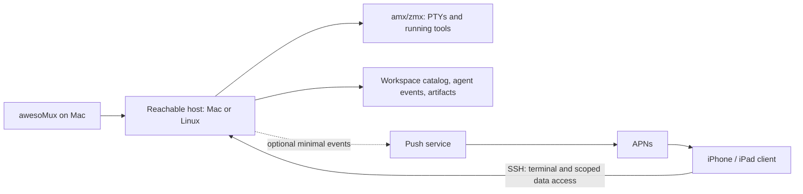

# Technical feasibility and architecture choices

2026-09-07 · research and proposals, not a reviewed implementation plan. No portability build, simulator run, network experiment, or signed distribution test was performed.

## The port is a different client

The host owns the shell and running tools. The iPhone/iPad owns a terminal presentation, input, local drafts and reconnectable views of host state. Reusing Swift models is plausible; reusing the desktop's AppKit window and process-launch path is not the same task.

Treat four layers separately:

| Layer | What it solves | What it does not solve |
| --- | --- | --- |
| Reachability: LAN, internet SSH, Tailscale | Finding and reaching a host | Keeping a terminal process alive or restoring UI state |
| Transport: SSH, potentially Mosh or another protocol | Authentication and movement of terminal/control data | Durable workspace ownership or safe stale-approval handling |
| Host persistence: amx/zmx | Keeping a PTY and process alive when a client detaches | Keeping the host powered on; synchronizing workspace organization |
| Workspace/agent protocol | Stable identity, state, artifacts and decisions | Replacing terminal rendering or guaranteeing mobile background execution |

Tailscale is an optional network route, not an awesoMux account system, SSH credential, or substitute for Mosh's recovery/local-prediction behavior. Mosh uses SSH to start the remote server and then UDP for terminal traffic. SSH is still needed for services such as forwarding and file operations. [Mosh design and usage](https://mosh.org/).

## Existing awesoMux assets, verified in the checkout

Baseline: public repository checkout `c30c2ec37b540605427f368aa057c791f2e1d742`; this is the inspected revision, not a claim that origin/main remains at that commit. Active development is occurring elsewhere.

| Existing asset | Evidence | Mobile implication |
| --- | --- | --- |
| Native workspace hierarchy and execution identities | [CONTEXT.md](../../awesomux/CONTEXT.md), [PaneExecutionPlan.swift](../../awesomux/Sources/AwesoMuxCore/Models/PaneExecutionPlan.swift) | Reuse meaning and IDs; adapt view layout |
| Named remote-owned session support | [Remote persistence](../../awesomux/docs/remote-session-persistence.md) | A real persistence foundation already exists; do not re-plan it as wholly absent |
| Remote persistence limitations | Same document, “What survives” | Reconnect is manual; rich state, history, scripted input, cwd and close-time liveness are absent on this path |
| Managed Linux helper | [Linux helper](../../awesomux/docs/remote-linux-helper.md) | Versioned deployment and activity/file handoff patterns exist; this helper does not supply persistence and is bypassed for named remote sessions |
| Agent events and exact provider identities | [Runtime channel](../../awesomux/docs/agent-runtime-side-channel.md), [ADR-0033](../../awesomux/docs/adr/0033-agent-transcripts-use-exact-provider-identities.md) | Preserve exact provider/session identity; do not infer a conversation from cwd |
| Permission transport and coordinator | [ADR-0028](../../awesomux/docs/adr/0028-permission-decision-transport-bridge-primary.md), [BridgePermissionCoordinator.swift](../../awesomux/Sources/awesoMux/Services/BridgePermissionCoordinator.swift) | Existing primitives and policy to investigate; not proof that every agent has a mobile-actionable approval API |
| File-backed Markdown review | [Plan annotations](../../awesomux/docs/plan-annotations.md), [context](../../awesomux/CONTEXT.md) | Reuse marker semantics; remote writes need authorization and revision conflicts because existing remote documents are read-only snapshots |
| Multi-client terminal resize arbitration | [zmx loop.zig](../../awesomux/vendor/zmx/src/loop.zig) at local submodule `67c6f63c9f27e96733015f3099363a92d73e836e` | `handleResize` limits resize to the leader; a useful existing mechanism, not a verified mobile UX contract |
| Partly separated Core and protocol targets | [Package.swift](../../awesomux/Package.swift) | Candidate reusable code; manifest currently declares macOS 15, not an iOS product; portability must be compiled and tested |

Important identity detail: `AWESOMUX_SESSION_ID` is launch provenance and does not follow a pane moved to another workspace. The runtime documentation says no dynamic current-workspace query exists today. A mobile catalog must use current membership keyed by pane ID, not assume the launch environment is the present workspace tree.

## Three connection architectures

### A. SSH plus a narrow host companion — preferred first experiment

Use an embedded iOS SSH library for terminal PTY channels. Start or attach the existing host backend. Fetch a capability/catalog snapshot and subscribe to supported events through a separate SSH channel or SSH-forwarded local endpoint. Reuse existing protocol concepts where possible; an SSH channel is not automatically an existing rich workspace API.

The host companion provides only the missing catalog/event/artifact functions. Determine which need a persistent process: locked-phone notifications need a host observer while the app is gone; foreground terminal access can use connection-scoped commands. Avoid a separate daemon per feature.

Advantages: existing authentication, encryption, jump-host and forwarding concepts; useful plain SSH fallback; no mandatory public listener or hosted terminal relay. Costs: selecting and packaging a capable iOS SSH dependency, credential UX, mobile reconnection, and defining the rich remote API the desktop does not yet expose.

### B. Headless awesomuxd with WebSocket/TLS — July proposal

A persistent host service owns a versioned mobile API, terminal attachment, catalog, pairing and push events. The July plan puts it behind Tailscale and pinned TLS, with a later relay.

Advantages: a controlled protocol for richer workspace operations; less dependence on shell command parsing. Costs: new service lifecycle, authentication, certificate rotation, pairing/revocation, terminal framing, backpressure, upgrades, and host networking. One WebSocket does not remove these problems.

Choose this if the SSH experiment demonstrates that a rich persistent API is materially simpler or more reliable this way. Do not choose it merely because the previous plan named the targets.

### C. Hosted connectivity and managed execution

A service could broker access or supply development machines. That expands the customer audience but brings operations, abuse prevention, infrastructure margins, account recovery and support. It is unnecessary to prove the workspace experience. Defer it until setup failures or willingness to pay demonstrate a need.

The host can be the user's desktop or another machine. A MacBook that sleeps cannot keep running its agents or serve live context. A session on an always-on Linux host can survive the laptop going away. Neither topology provides transparent migration of existing processes to a different host.

## Renderer: choose with a fidelity experiment

**SwiftTerm is the lower-cost first candidate**, because it supplies an embeddable Swift terminal with an iOS UI and MIT licensing. Its current README distinguishes the 2.0 API from tagged 1.x releases, so select an exact revision/version and matching documentation when experimenting. [SwiftTerm](https://github.com/migueldeicaza/SwiftTerm).

**Ghostty remains a serious candidate.** Upstream describes a standalone Zig module and a developing C API separately from the desktop GUI. That invalidates treating an old desktop embedding limitation as proof that remote byte-fed terminal rendering on iOS is impossible. It does not establish that awesoMux's current GhosttyKit wrapper can be dropped into an iOS app. [Ghostty's libghostty update](https://ghostty.org/docs/install/release-notes/1-3-0#libghostty).

Test the actual reconnect output emitted by amx, not merely an ANSI color demo. Compare full-screen editor state, alternate screens, cursor/modes, Unicode width, selection, terminal replies, synchronized output and retained scrollback. A snapshot produced by one engine and interpreted by another can reveal mismatches.

Prefer the existing renderer that meets the quality gates with the least maintenance. Do not build a new renderer or migrate the desktop for visual brand consistency alone. Supporting one mobile renderer is enough; a permanent renderer abstraction earns its cost only if a second implementation becomes real.

## Mobile lifecycle and data correctness

iOS background strategies are purpose-limited and system-managed. Design for suspension and termination rather than promising a permanently running client socket. Reconnect on foreground, refresh authoritative state, and show local drafts/cache without pretending they are live. [Apple background execution guidance](https://developer.apple.com/documentation/backgroundtasks/choosing-background-strategies-for-your-app).

Required invariants for the eventual protocol:

- **One authoritative owner per session.** The phone must know which host/backend namespace and session incarnation it addresses. A reused human-readable session name is insufficient after a host restart.
- **Catalog freshness and recovery.** Reconnect requests a snapshot or resumes a supported event sequence. A sequence gap triggers resynchronization. A host disappearing is not evidence that its sessions completed.
- **No uncertain-input replay.** A lost network acknowledgement does not prove a shell command failed to arrive. Do not automatically resend keystrokes or prompt submissions. Keep an unsent draft; show uncertain delivery when applicable.
- **Server-checked actions.** Permission replies carry a request identity, target session incarnation and current validity. Host-side deduplication/conflict handling resolves concurrent Mac/phone answers. Expired or unrecognized requests fall back to the agent's native interaction, never an invented allow.
- **Bounded data.** Terminal output, history, transcripts, file transfers and events need bounded memory and backpressure. Define whether a reconnect restores a screen, retained history, or both. Do not promise unlimited scrollback.
- **Host-owned artifact writes.** Resource identity contains host and path/provenance. An annotation write includes a base revision and fails visibly if the file changed. A copied cache filename is not write authority.
- **Explicit control.** Observing does not steal terminal dimensions. Claiming input control has a defined effect on all attached clients; losing a client releases control predictably.

These are behavior requirements. Wire field names, framing, storage engines and target splits remain implementation choices after experiments.

## Workspace ownership is the unresolved structural question

Today the desktop owns its workspace snapshot, while amx owns per-terminal persistence. A phone that can create a session or move a pane becomes a second writer of workspace intent.

For a first experiment, export a read-only catalog and attach existing sessions. For a useful independent mobile product, add host-owned session registration and creation so those sessions are not mistaken for abandoned desktop daemons. Define one writer for catalog mutations; do not have the phone edit desktop JSON over SFTP.

A later host catalog may be the right owner, with the Mac and mobile app submitting operations. That is a desktop architecture decision with compatibility and migration consequences. Test it on one workspace before trying to synchronize every desktop setting.

## Security and notification boundaries

Use established SSH host-key verification and platform credential storage. Make changed host keys, revoked devices and denied access legible. Keychain protection and Secure Enclave key support are different capabilities; do not promise that imported keys can all live in the Enclave. Pick the SSH/key dependency after checking required algorithms and platform integration.

Terminal output and agent transcripts are untrusted presentation data. They cannot silently authorize commands, access arbitrary host files, upload clipboard contents, or manufacture trusted permission UI. Image/file transfer should default to the selected host, not a public URL.

A direct connection need not involve awesoMux servers. Background push is a separate data path: authenticated host event → small push service → APNs → device; tapping fetches fresh private details from the host. Start with opaque IDs and generic notification text. Log neither terminal content nor credentials. Relay failure must not prevent direct terminal access.

APNs provider signing keys belong in controlled provider infrastructure. Do not distribute the production key to customers or beta testers. Even a private beta should use a developer-controlled sender or omit push until one exists. [Apple APNs token authentication](https://developer.apple.com/documentation/usernotifications/establishing-a-token-based-connection-to-apns).

An eventual connection relay needs a separate threat model and end-to-end identity design. “Dumb pipe” is not sufficient analysis: pairing substitution, device revocation, replay, metadata and denial of service still matter.

## App distribution and licensing questions

A useful review/demo environment, working backend access, clear privacy disclosures and a truthful explanation of remote execution should be prepared before external distribution. Existing terminal apps are precedent, not a guarantee of acceptance. Select the applicable purchase flow when the commercial offer is concrete. [Apple review guidelines](https://developer.apple.com/app-store/review/guidelines/).

Mosh upstream is GPLv3+ and documents an App Store exception. That exception does not turn it into MIT code. The old plan's categorical “cannot ship Mosh at all” wording is not an adequate dependency analysis. Review the exact implementation, dependencies, distribution terms and chosen app license before embedding; retain the project's prohibition on copying GPL source into MIT awesoMux. Mosh-compatible behavior and upstream Mosh code are not identical choices. No license or commercial source decision is made here. [Mosh upstream](https://mosh.org/).

## Bounded experiments before a build commitment

| Experiment | Answer it must produce | Stop condition |
| --- | --- | --- |
| Terminal and reconnect | Can one real session survive app termination/network transitions with acceptable input and snapshot fidelity? | Unresolved input corruption or inability to resume the correct session |
| Two-client ownership | Can a phone observe and then control without surprising the Mac? | Resize/input rules cannot be made understandable |
| Rich host access | Can existing pane/agent/artifact identity be exposed over SSH while the GUI is closed? | Required data only exists inside the GUI; document exact new persistent responsibility |
| Safe agent response | Can a supported provider resolve one real pending request while both clients are active? | Stale or duplicate responses can authorize the wrong action |
| iPad work | Can a physical iPad complete a representative development session? | Input/focus shortcomings prevent ordinary work |
| Onboarding and push | Can a new tester connect, lock the phone, receive an alert and reach the correct current request? | Setup requires founder intervention or the push path exposes sensitive content |

Each experiment should leave a small reproducible check and written findings. None was run in this documentation session. A successful experiment authorizes confidence in that behavior, not an entire release schedule.

## Research provenance and corrections

Private sources were read with permission and remain in this private working set.

- [Internal repository](https://github.com/Interactive-Buffoonery/awesomux-internal) was verified as private and active at `4c60aa78583d1cb207510a145a45e7767b8e4a17`. Its README identifies it as private planning extracted from the original repository.
- [July 2 iOS plan](https://github.com/Interactive-Buffoonery/awesomux-internal/blob/4c60aa78583d1cb207510a145a45e7767b8e4a17/docs/plans/ios-companion-plan.html) was read completely via the local archived copy, then verified byte-identical to the live internal file. SHA-256: `dd13c43f277dec7662dd8443cdbd6389bc41ff2fe73876b24a853ea0f36c2e38`.
- `awesomux-private` is the archived predecessor; its local checkout is `8cb0b44`, dated July 12. Its architectural claims were not treated as current code.
- JiggyBrain sources: July 16 “awesoMux Moshi integration research”; July 23 “awesoMux herdr, amx, and Multiplexing vs Moshi”; July 24 “awesoMux Remote Session Attach and the iOS Client Question”; August 31 “zmx vs tmux Backend, iOS App Compat”; and the awesoMux project MoC. Their historical conclusions were checked against current sources where used.

| Earlier claim or choice | September assessment |
| --- | --- |
| Remote-owned sessions still need building | Now implemented for named remote sessions; rich context and automatic reconnect remain gaps |
| Dashboard/notifications occupy an uncrowded lane | Outdated; see current competitive evidence |
| Whole workspace continuation is automatically unique | Unproven; Moshi has desktop, grouping and related continuity features |
| Tailscale sufficiently substitutes for Mosh | Reachability and terminal recovery/prediction differ; measure the chosen transport |
| Blink definitely exposes native tmux control-mode UI | Not established by reviewed official documentation; exclude from rationale |
| zmx choice must be reversed for iOS | No evidence for replacement; standard remote PTY attach is independent of a native tmux picker |
| All Core code is portable unchanged | Not demonstrated; current package/platform/dependency graph needs an iOS compile check |
| Production APNs key on beta users' Macs is acceptable | Rejected as a distribution pattern; keep signing custody controlled from the start |
| CGNAT-address filtering establishes trusted tailnet membership | Insufficient identity check; use authenticated transport and explicit authorization, not an IP-range assumption |
| Closing the app shell is “clone-proof”; push service is a moat | Overstated; paid distribution, product quality and customer trust must carry the business |
| July's weeks and new ADR numbers are ready to execute | Stale, unvalidated estimates and identifiers; plan again only after experiments |

The useful retained ideas are a full terminal peer, headless host access, adaptive phone/tablet presentation, file-backed review, and explicit multi-client behavior. This document explores how to prove them with the least new machinery.
